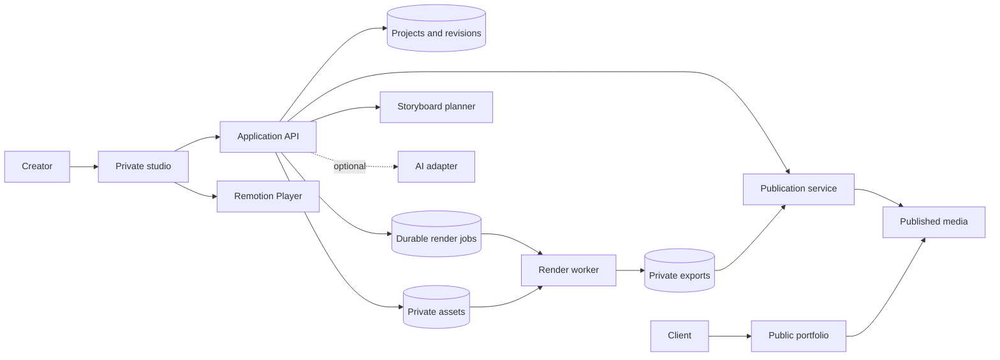

> Current decision, 16 October 2026: the studio is account-free and persists projects plus screenshot blobs in browser IndexedDB. Firebase Authentication and cloud workspace persistence were removed from the application; provisioned Firebase resources and their private rules remain untouched as legacy infrastructure. See [workspace storage and Firebase history](08-membership-and-firebase.md). The PostgreSQL/Next.js discussion below is historical proposal material, not the implemented stack.

# Proposed application architecture

## Architectural decision

Use a modular application with a separately runnable rendering worker. Keep project facts, storyboard planning, and visual composition separate. A change to AI provider or storage should not require rewriting scenes, and a visual template change should not alter project ownership or publication rules.

Recommended stack: React with TypeScript; Next.js as a candidate for public pages and private studio/API; a relational database such as PostgreSQL for hosted metadata; private object storage for assets; and a durable job mechanism for rendering. These are proposed choices, not installed dependencies. A local prototype can use simpler persistence, but should retain the same conceptual boundaries.

The diagram shows responsibility and data flow, not a requirement for separate microservices. Planner and publication service can be modules inside the web application. The worker is a process boundary because rendering has a different lifetime and resource profile from web requests.

## Module responsibilities

| Boundary | Owns | Does not own |
| --- | --- | --- |
| Project domain | Facts, role, evidence, status, revision checks | Frame animation |
| Asset service | Upload authorization, validation, derivatives, retention | Storytelling claims |
| Storyboard planner | Scene selection, copy placement, timing, constraints | Storage credentials or AI calls inside frames |
| Video templates | Visual rendering from validated inputs | Database queries, authentication, provider keys |
| AI adapter | Draft suggestions and provenance | Final facts, publication, executable templates |
| Render service | Snapshot creation, queue submission, progress | Mutable draft editing |
| Render worker | Resolve inputs, run pinned template, write output | Public publishing decisions |
| Publication service | Choose an export and public content revision | Editing a completed export |

Proposed eventual source organization: `app/` for routes, `features/projects/` and `features/studio/` for product workflows, `domain/` for contracts and planning, `video/` for compositions and scenes, `server/` for authenticated services, and `worker/` for rendering. These directories have intentionally not been created. Extract packages only when actual build/runtime boundaries warrant it.

## Upload and asset flow

The owner requests an upload slot. The server validates authorization and limits and returns scoped upload access. After upload, the server verifies actual file type, dimensions, decode success, and size before marking it usable. Do not trust extensions or browser-supplied metadata. Restrict the first release to static raster images; arbitrary SVG/HTML input is unnecessary.

Keep originals private and generate bounded preview/render derivatives. Preserve aspect ratio and source dimensions; do not silently stretch. Normalize orientation and color handling where supported. Record a content hash so a render references exact asset bytes. Let the creator redact sensitive information before publication, producing a new derivative rather than merely hiding pixels with an editor overlay.

Browser object URLs can help preview a newly selected file, but they cannot be sent to a remote render worker. Persist the upload first, then refer to its asset ID. Resolve preview URLs and worker access separately. A worker can stage authorized assets locally or obtain URLs whose lifetime covers the job. Never store expiring signed URLs as the only durable asset identity.

## Export lifecycle

1. The client submits project revision, storyboard revision, template version, and output profile with an idempotency key.
2. The API checks ownership, schema validity, supported format, available assets, and quotas. It freezes a render snapshot.
3. Persist the job before dispatch. A database-backed queue can be sufficient for one worker; use leases and atomic claims. If using a separate broker, an outbox/reconciliation mechanism prevents saved-but-never-enqueued jobs.
4. The worker claims a lease, stages assets, checks template/runtime compatibility, then renders with the same planned inputs used in preview.
5. Write output to an attempt-specific temporary location. Validate the finished artifact before atomically marking the job successful and exposing download access.
6. Generate a poster from a deliberate representative frame and record dimensions, duration, byte size, codec, checksum, and timings.
7. The creator reviews and publishes a successful artifact. Publishing updates the public pointer and associated case-study snapshot together.

Edits during export create a new draft revision; they never change the in-flight snapshot. An export can be reused only when normalized inputs, asset hashes, template bundle, output profile, and relevant runtime versions match. Scope caches to the owner to avoid exposing private artifacts.

## Job reliability

Use a lifecycle such as queued → preparing → rendering → finalizing → succeeded, with failed/canceled terminal outcomes and a cancel-requested flag. Heartbeats and lease expiration recover crashed workers. Retries should be bounded, use a new attempt ID, and distinguish transient storage/network failures from invalid inputs. Proposed default: at most two retries for transient failures; validate through operational experience.

Treat duplicate queue delivery as normal. A completed job is not rerendered on redelivery. A stale worker cannot overwrite a newer attempt's result; use a lease/fencing token in finalization. Cancellation is best-effort until worker acknowledgment. If completion races with cancellation, apply a documented atomic terminal-state rule and retain cleanup information.

Persist progress so refreshing the page does not lose the job. Initially poll a status endpoint; add event streaming only if needed. Label stages accurately rather than implying render percentage includes queue wait and final upload. Allow owners to download earlier successful versions while a new export runs.

## Deployment choices

**Local proof:** studio and render worker on the development machine, a few sample assets, and one composition. Measure quality and runtime before adding cloud complexity.

**Hosted MVP:** web frontend/API, database, object storage, and one container/VM render worker. A static/serverless web host may serve the application while a separate worker handles export. Do not assume a normal HTTP function can sustain headless-browser rendering within its resource/time limits. Verify the provider's current constraints.

**Growth:** add worker concurrency only after measuring per-job memory. Then consider distributed rendering such as Lambda, while preserving the job/snapshot contract. Provider selection should consider operational comfort, asset region, latency, and actual export volume.

**Browser export alternative:** worth testing if privacy and minimal infrastructure dominate. It needs a compatible template profile, device/codec capability checks, visible fallback, and treatment of interrupted tabs. It should not silently replace the canonical worker export until visual parity is demonstrated. [Remotion browser constraints](https://www.remotion.dev/docs/client-side-rendering/limitations)

## Public delivery and access control

Keep studio routes authenticated. If hosted, enforce object ownership on every project, asset, job, download, AI, and publication request; knowing an ID is not authorization. Single-owner operation still needs authentication once exposed to the internet.

Serve public pages from published snapshots only. Publication copies/authorizes selected derivatives and outputs for public delivery; private originals and internal notes remain private. Unpublish removes public references and schedules cache invalidation where supported. A previously downloaded video cannot be recalled.

Do not allow the renderer to fetch arbitrary submitted URLs. Resolve approved asset IDs; constrain worker network access. Keep API keys in server-side secret storage, never in Remotion props, browser bundles, logs, screenshots, or exported project files. Treat project notes and AI outputs as plain text, with safe URL validation for links.

## Operations and cost

Record job ID, attempt, template version, stage durations, error category, peak resource usage where available, and output size. Avoid logging full notes, signed URLs, or credentials. Limit simultaneous jobs, total duration, image dimensions, and retention before opening uploads to multiple users.

Estimate monthly cost as render compute + storage + delivery bandwidth + database/queue + any applicable Remotion license + optional AI. Benchmark at least a typical and a worst-case accepted project. Do not assume a 30-second video takes 30 seconds to render. Frame count, resolution, effects, assets, concurrency, and runtime all matter.

Back up metadata and preserve immutable assets referenced by published or retained exports. Define deletion policy: unpublish, block new jobs, cancel/drain active references, then delete eligible originals/derivatives/artifacts and cached copies. Failed attempt scratch files need a separate short retention period.
